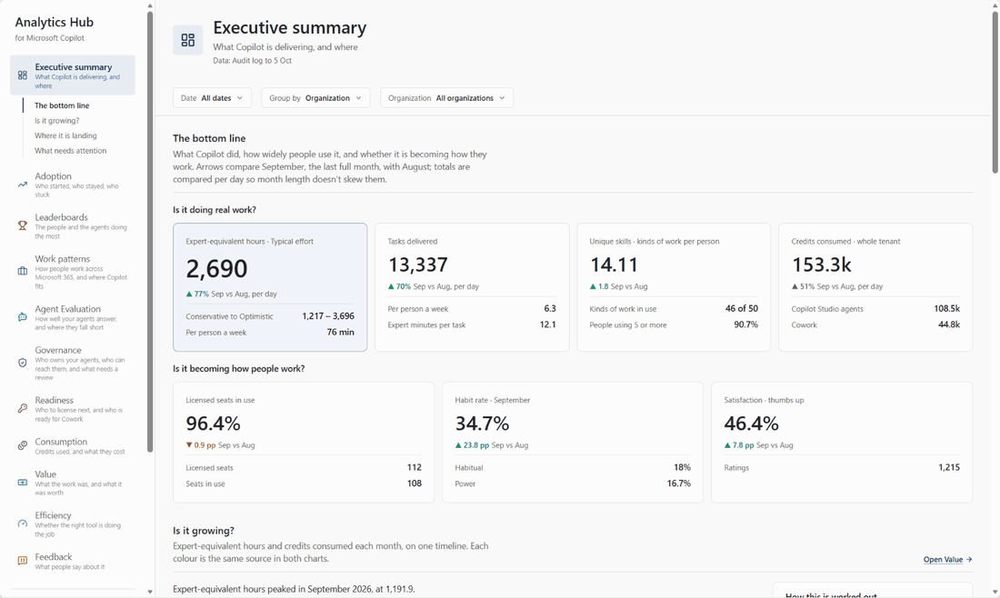
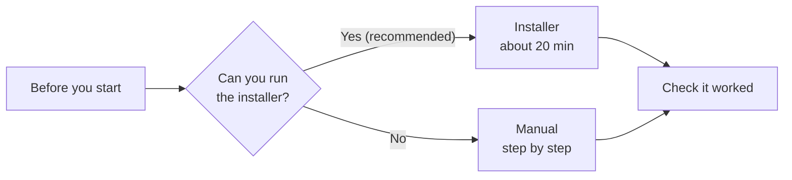

<div align="center">

<br>

# 📊 Analytics Hub for Microsoft Copilot

**See how your organisation uses Microsoft 365 Copilot and agents, and the hours and value they deliver.**

<br>

All reports and guides can be found on the [Analytics Hub site](https://microsoft.github.io/Analytics-Hub/).

**Want a more targeted report?** [ValueLens](https://github.com/microsoft/ValueLens-for-Microsoft-Copilot)
covers the adoption and value parts of Analytics Hub, and
[Consumption Central](https://github.com/microsoft/ConsumptionCentral-for-Microsoft-Copilot) covers
credit consumption and cost.

<br>

**Found this useful? ⭐ Star this repo to help others discover it!**

<br>

**[Before you start](#before-you-start)** &nbsp;·&nbsp; **[Installer](#installer)** &nbsp;·&nbsp; **[Manual](#manual)** &nbsp;·&nbsp; **[After setup](#after-setup)**

<br>

</div>

## Videos

[](docs/APP-GUIDE.md)

**The app, page by page** *(silent, about 2 minutes, sample data)*

https://github.com/user-attachments/assets/b415625d-c2ae-467f-9a91-59ef9adca6c8


<a id="what-you-get"></a>

## What you get

- An app and Power BI reports on Copilot and agent use, value and cost.
- Fresh data every day, kept in your own tenant.
- Analytics Hub is free. You pay for the Fabric capacity or Azure resources it runs on.

<a id="getting-started"></a>

## Before you start

- [ ] A Fabric capacity (F2+ or a [free trial](https://learn.microsoft.com/fabric/fundamentals/fabric-trial#method-1-start-a-new-trial-capacity-from-the-account-manager)), or Owner on an Azure subscription or resource group.
- [ ] Power BI Pro.
- [ ] Rights to register an app in Entra, or an admin who can.
- [ ] A few minutes from your admins. Send each one [their row](docs/PREREQUISITES.md#at-a-glance).
- [ ] A Windows 10 or 11 PC. No admin rights needed.

<a id="fabric-or-azure"></a><a id="architecture-and-running-costs"></a>

Not sure? Pick [Fabric](1-fabric/). [Azure](2-azure/) costs about $5–40 a month for a small tenant
([costs](docs/ARCHITECTURE.md)). Full list: [Prerequisites](docs/PREREQUISITES.md).

## Choose your path



| Path | Suits |
|---|---|
| **[Installer](#installer)** (recommended, fastest) | Most people. It sets everything up and tells you what's left. |
| **[Manual](#manual)** (step by step) | You can't run the installer, or want to see each piece. |

<a id="automatic-the-installer"></a><a id="run-the-installer"></a>

## Installer

1. Paste this into PowerShell, or [download the exe](https://github.com/microsoft/AnalyticsHub-Dashboard/releases/latest/download/AnalyticsHubInstaller.exe):

   ```powershell
   irm https://github.com/microsoft/AnalyticsHub-Dashboard/releases/latest/download/install.ps1 | iex
   ```

2. In your browser, choose **Set up Analytics Hub** and sign in.
3. Choose **Microsoft Fabric** or **Your Azure subscription**.
4. Answer the questions (about 5 minutes).
5. Check the plan and choose **Go ahead**. Keep the PC awake.
6. Do what the Done page lists, then [check it worked](docs/INSTALL.md#check-it-worked).

Blocked by IT policy? Don't work around it. See [other ways to run it](docs/INSTALL.md).

<a id="manual-step-by-step"></a>

## Manual

**Fabric** ([watch the video](fabric/README.md#set-it-up-by-hand) first):

1. [Prerequisites](docs/MANUAL-INSTALL.md#1-prerequisites)
2. [Load the data](fabric/notebooks/README.md)
3. [Publish the report](fabric/notebooks/README.md#load-the-data)
4. [Schedule the pipeline](fabric/pipelines/README.md)
5. [Deploy the app](app/README.md#deploy-it-by-hand) (optional)
6. [Check it worked](docs/MANUAL-INSTALL.md#3-verify)

**Azure:** [seven steps in Azure Cloud Shell](docs/MANUAL-INSTALL.md#azure).

## After setup

- **Refresh:** automatic, every day. To run it now, start the installer again.
- **Update or remove:** [Update](docs/UPDATE.md).
- **Help:** [Troubleshooting](docs/TROUBLESHOOTING.md) · [FAQ](docs/FAQ.md) ·
  [open an issue](https://github.com/microsoft/AnalyticsHub-Dashboard/issues).

---

<a id="disclaimer"></a>

<details>
<summary><strong>Disclaimer</strong></summary>

- **This isn't the official Copilot report.** The official sources are the
  [Microsoft 365 admin center Copilot usage reports](https://learn.microsoft.com/en-us/microsoft-365/admin/activity-reports/microsoft-365-copilot-usage)
  and the [Viva Insights Copilot Dashboard](https://learn.microsoft.com/en-us/viva/insights/org-team-insights/copilot-dashboard).
  Analytics Hub takes its Copilot figures mainly from the Purview audit log, which isn't the
  authoritative source, so its numbers may not always match those reports exactly.
- **You're responsible for the data once it's extracted.** Analytics Hub copies data into your own
  Fabric workspace or Azure subscription. The retention, deletion and other policies you set in
  Purview, Microsoft 365, Entra ID and the other sources don't apply to those copies. Managing that
  data and meeting your organisation's requirements is up to you.
- **Usage and compliance.** Microsoft has no visibility into the data you put in, nor control over
  how the tool is used. You're responsible for making sure your use complies with all applicable
  laws and regulations, including data privacy and security. Microsoft disclaims all liability
  arising from use of this tool.
- **Experimental.** It isn't supported through Microsoft support channels. Please open an issue in
  this repo.

</details>

<a id="reference"></a><a id="troubleshooting"></a><a id="why-its-more-than-the-built-in-reports"></a><a id="what-you-can-do-with-it"></a><a id="optional-add-ons"></a><a id="what-data-is-collected"></a><a id="power-bi-reports"></a><a id="documentation"></a><a id="whats-here"></a><a id="repository-layout"></a><a id="copilot-managed-app-preview"></a><a id="help"></a>

<details>
<summary><strong>Reference, archived options and contributing</strong></summary>

- [All docs](docs/README.md): the data, permissions and costs.
- [App guide](docs/APP-GUIDE.md) · [Installer reference](installer/README.md) ·
  [Release notes](CHANGELOG.md)
- Archived: parked ideas, like the Copilot Managed App, are in [ideas](ideas/README.md). Not
  supported.
- [Support](SUPPORT.md) · [Security](SECURITY.md) · [Contributing](CONTRIBUTING.md) ·
  [MIT licence](LICENSE)

Created by [Keith McGrane](https://github.com/Keithland89). Keith reviews every pull request
against `main`, and only Keith creates release tags.

</details>