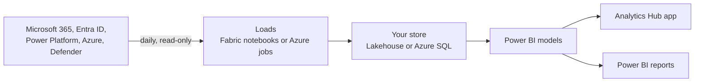

# Analytics Hub for Microsoft Copilot

See how your organisation uses Microsoft 365 Copilot and agents, and the hours and value they
deliver. One installer sets it up in your tenant, on **Microsoft Fabric** or in **your own Azure
subscription**.

[](docs/APP-GUIDE.md)

**Watch first: the app, page by page** *(silent, about 2 minutes, sample data)*

https://github.com/user-attachments/assets/b415625d-c2ae-467f-9a91-59ef9adca6c8

> Prefer to download it? [Get the demo video](media/AnalyticsHub-Demo.mp4).

> **Moved from ValueLens.** Analytics Hub used to be paths 1 and 2 of
> [ValueLens for Microsoft Copilot](https://github.com/microsoft/ValueLens-for-Microsoft-Copilot).
> Existing installs keep working: see [I used ValueLens](docs/FAQ.md#i-used-valuelens-what-changes).

## Why it's more than the built-in reports

The [Microsoft 365 admin center Copilot reports](https://learn.microsoft.com/en-us/microsoft-365/admin/activity-reports/microsoft-365-copilot-usage)
and the [Viva Insights Copilot Dashboard](https://learn.microsoft.com/en-us/viva/insights/org-team-insights/copilot-dashboard)
are the official numbers. Analytics Hub adds:

| | What you get |
|---|---|
| **History** | Every Copilot interaction from the audit log, kept in your own Fabric or Azure store for as long as you choose |
| **Your organisation** | Every page by department, job title, manager and location, from Entra ID or Workday |
| **Agents** | Who uses each agent, who owns it, who can reach it and what needs a review |
| **Value** | The hours saved and what they're worth, with task times you can change |
| **Credits and cost** | Copilot Studio, Cowork and Azure AI spend in one place |
| **Your data, your way** | An app, Power BI reports and models to build on, and questions in plain language on the Ask page |

## Disclaimer

- **This isn't the official Copilot report.** The official sources are the
  [Microsoft 365 admin center Copilot usage reports](https://learn.microsoft.com/en-us/microsoft-365/admin/activity-reports/microsoft-365-copilot-usage)
  and the [Viva Insights Copilot Dashboard](https://learn.microsoft.com/en-us/viva/insights/org-team-insights/copilot-dashboard).
  Analytics Hub takes its Copilot figures mainly from the Purview audit log, which isn't the
  authoritative source, so its numbers may not always match those reports exactly.
- **You're responsible for the data once it's extracted.** Analytics Hub copies data into your own
  Fabric workspace or Azure subscription. The retention, deletion and other policies you set in
  Purview, Microsoft 365, Entra ID and the other sources don't apply to those copies. Managing that
  data and meeting your organisation's requirements is up to you.

## What you can do with it

| Page | Answers | Data from |
|---|---|---|
| **Executive summary** | What is Copilot delivering, and where? | All of the below, in one page |
| **Value** | What was the work, and what was it worth? | Audit log, time per task |
| **Consumption** | What credits did we use, and what did they cost? | Copilot credits, Azure cost *(Credit consumption add-on)* |
| **Efficiency** | Is the right tool doing the job? | Audit log |
| **Adoption** | Who started, who stayed, who stuck? | Purview audit log, licences, org data |
| **Leaderboards** | Which people and agents do the most? | Audit log, Agent 365 registry |
| **Work patterns** | Where does Copilot fit in everyday Microsoft 365 work? | Microsoft 365 usage reports *(optional)* |
| **Readiness** | Who should get a licence next, and who is ready for Cowork? | Audit log, licences |
| **Agent Evaluation** | How well do our agents answer? | Copilot Studio transcripts *(Agent Evaluator add-on)* |
| **Governance** | Who owns our agents, who can reach them, what needs a review? | Agent 365 registry, Azure Resource Graph, Defender *(optional)* |
| **Feedback** | What do people say about it? | Product feedback export *(optional)* |
| **Assumptions** · **Appendix** | How long does each task take? What does each metric mean? | The model's task times and glossary |

Screenshots and every section, page by page: **[App guide](docs/APP-GUIDE.md)**.

## What data is collected

Everything is read-only, and stays in your tenant.

| Source | What | |
|---|---|---|
| Purview audit log | Each Copilot interaction: who, when, which app or agent | Always |
| Microsoft 365 licences | Who has a Copilot licence | Always |
| Entra ID, or a Workday export | Department, job title, manager and location | Always |
| Microsoft 365 usage reports | Everyday Teams, Outlook, Word and other activity | On by default |
| Agent 365 registry | Each agent, its owner and who can reach it | Optional |
| Copilot Studio, Cowork and Azure AI | Credits used, and what they cost | Optional |
| Microsoft Defender, Azure Resource Graph | AI apps in use, agent risk and configuration, Foundry | Optional |
| Copilot Studio transcripts | How well agents answer | Optional, Fabric |
| Product feedback export | What people say about Copilot | Optional, Fabric |

<a id="optional-add-ons"></a>
Optional sources are cards on the installer's **Data sources** screen, or extra steps in
[Manual install](docs/MANUAL-INSTALL.md#2-install). Each table and column:
[Data dictionary](docs/DATA-DICTIONARY.md). Each permission:
[Prerequisites](docs/PREREQUISITES.md#permissions). Which agents the audit log covers:
[FAQ](docs/FAQ.md#which-agents-does-the-audit-log-cover).

## Getting started

Two paths. Each is the same 3 steps: **Prerequisites → Install → Verify**.

| | **Automatic** (recommended) | **Manual** |
|---|---|---|
| **How** | The installer sets it up and checks it, about 20 minutes | You follow the steps, no installer |
| **Runs on** | Fabric or Azure | Fabric only |
| **Then** | Repair, update and status from the installer | You update it by hand |
| **1. Prerequisites** | [Prerequisites](docs/PREREQUISITES.md) | [Prerequisites, plus a few extras](docs/MANUAL-INSTALL.md#1-prerequisites) |
| **2. Install** | [Install](docs/INSTALL.md) | [Manual install](docs/MANUAL-INSTALL.md#2-install) |
| **3. Verify** | [Verify](docs/VERIFY.md) | [Verify by hand](docs/MANUAL-INSTALL.md#3-verify) |

Not sure? Use **Automatic**. Pick where it runs; both give you the same data, model, measures
and app pages.

| Where | You need |
|---|---|
| **[Fabric](fabric/)** (recommended) | A Fabric capacity, F2 or larger, or a [free trial](https://learn.microsoft.com/fabric/fundamentals/fabric-trial#method-1-start-a-new-trial-capacity-from-the-account-manager) |
| **[Azure](azure/)** | An Azure subscription or resource group, and a Power BI workspace. No Fabric |

### Automatic: the installer

1. **Prerequisites.** Check the **[Prerequisites](docs/PREREQUISITES.md)**: one table of who does
   what, and how long it takes. Send each admin their row before you start.
2. **Install.** On Windows 10 or 11, paste this into PowerShell. It needs no admin rights, and
   opens the steps in your browser:

   ```powershell
   irm https://github.com/microsoft/AnalyticsHub-Dashboard/releases/latest/download/install.ps1 | iex
   ```

   Or download the exe and open it:

   [](https://github.com/microsoft/AnalyticsHub-Dashboard/releases/latest/download/AnalyticsHubInstaller.exe)

   To check a download, see [Check the download](docs/INSTALL.md#check-the-download). If your
   organisation blocks both, use an [IT-approved Node.js](docs/INSTALL.md#it-approved-nodejs) or
   [Azure Cloud Shell](docs/INSTALL.md#locked-down-tenant--azure-cloud-shell), or ask your IT team.
   Don't work around the policy. See **[Install](docs/INSTALL.md)**.
3. **Verify.** The first data arrives about 25 minutes after you choose **Go ahead**. See
   **[Verify](docs/VERIFY.md)**.

### Manual: step by step

Fabric only, without the installer. **[🎥 Watch the manual setup](fabric/README.md#set-it-up-by-hand)**
first.

1. **Prerequisites.** The [Prerequisites](docs/PREREQUISITES.md), plus an app registration you
   create yourself. See [the extras](docs/MANUAL-INSTALL.md#1-prerequisites).
2. **Install.** Load the data, publish the report, schedule the pipeline, then deploy the app. See
   **[Manual install](docs/MANUAL-INSTALL.md#2-install)**.
3. **Verify.** Check the pipeline run, the data and the report. See
   **[Verify by hand](docs/MANUAL-INSTALL.md#3-verify)**.

**Then:** [Update](docs/UPDATE.md) · [Uninstall](docs/UNINSTALL.md) ·
[Troubleshooting](docs/TROUBLESHOOTING.md) · [Known issues](docs/KNOWN-ISSUES.md) ·
[FAQ](docs/FAQ.md) · [Release notes](CHANGELOG.md). These pages are also on the
[wiki](https://github.com/microsoft/AnalyticsHub-Dashboard/wiki).

## Architecture and running costs



Everything runs in your tenant. Analytics Hub is free; you pay for the Fabric capacity, or about
$5–40 a month of Azure for a small tenant. See **[Architecture and costs](docs/ARCHITECTURE.md)**.

<a id="reference"></a><a id="power-bi-reports"></a>

## Documentation

| Page | What it covers |
|---|---|
| [Prerequisites](docs/PREREQUISITES.md) · [Permissions](docs/PERMISSIONS.md) | Who does what, each permission and role, and costs |
| [Install](docs/INSTALL.md) · [Verify](docs/VERIFY.md) | The automatic path, in detail |
| [Manual install](docs/MANUAL-INSTALL.md) | The manual path: Fabric, step by step |
| [Update](docs/UPDATE.md) · [Uninstall](docs/UNINSTALL.md) | Keeping it current, and removing it |
| [Troubleshooting](docs/TROUBLESHOOTING.md) · [Known issues](docs/KNOWN-ISSUES.md) · [FAQ](docs/FAQ.md) | When something's wrong, or unclear |
| [Architecture and costs](docs/ARCHITECTURE.md) | What it creates, and what it costs |
| [App guide](docs/APP-GUIDE.md) | Every page, and the [Power BI reports](docs/APP-GUIDE.md#power-bi-reports) |
| [How the value is calculated](docs/METHODOLOGY.md) · [Data dictionary](docs/DATA-DICTIONARY.md) | The numbers, and every table and column |
| [Guide to the ValueLens Power BI report (PDF)](docs/ValueLens-Report-Interpretation-Guide.pdf) | Reading the main Power BI report, still named ValueLens |
| [Installer reference](installer/README.md) | Every installer option and command |
| [Release notes](CHANGELOG.md) | What changed |

<a id="whats-here"></a>

## Repository layout

| Folder | What it is | Who needs it |
|---|---|---|
| [`docs/`](docs/) | The pages above. Published to the [wiki](https://github.com/microsoft/AnalyticsHub-Dashboard/wiki) on every change | Everyone |
| [`installer/`](installer/) | `AnalyticsHubInstaller.exe`: sets up, repairs and updates Fabric or Azure installs | Automatic path |
| [`fabric/`](fabric/) | Notebooks, pipeline, flows and Power BI templates for Fabric. The installer deploys them | Manual path, or to see what's deployed |
| [`app/`](app/) | The Analytics Hub app: a Fabric app item, and the web app's front end on Azure | Manual path, or developers |
| [`azure/`](azure/) | Bicep, Container Apps jobs, SQL schema, web app and Teams package for Azure | Developers |
| [`core/`](core/) | `valuelens_core`, the Python shared by the Azure jobs and the Fabric Defender notebook | Developers |
| [`samples/`](samples/) | Synthetic sample data for demo mode | Demos |
| [`media/`](media/) | Screenshots and the demo video | Docs |
| [`scripts/`](scripts/) · [`tests/`](tests/) | Maintainer scripts that patch the templates, and the tests | Contributors |

## Help

[Open an issue](https://github.com/microsoft/AnalyticsHub-Dashboard/issues) ·
[Support](SUPPORT.md) · [Report a vulnerability](SECURITY.md) · [Contributing](CONTRIBUTING.md) ·
[MIT licence](LICENSE)

To contribute, open a pull request against `main`. Keith reviews and approves every change, and
only Keith creates release tags. See [Contributing](CONTRIBUTING.md#reviews-and-releases).

<details>
<summary>Usage and compliance disclaimer</summary>

While this tool helps customers understand the business value of their AI usage data, Microsoft has
**no visibility** into the data customers input, nor control over how the tool is used. Customers
are solely responsible for ensuring their use complies with all applicable laws and regulations
(including data privacy and security). **Microsoft disclaims all liability** arising from use of this
tool.

This is an **experimental** tool with Purview audit logs as the primary source. Audit logs
provide visibility into Copilot/agent interactions but are not intended as the sole source of truth
for licensing or full‑fidelity reporting. Not supported through Microsoft support channels — please
open an issue in this repo.
</details>
