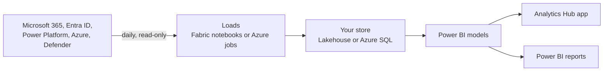

# Analytics Hub for Microsoft Copilot

See how your organisation uses Microsoft 365 Copilot and agents, and the hours and value they
deliver. One installer sets it up in your tenant, on **Microsoft Fabric** or in **your own Azure
subscription**.

[](docs/APP-GUIDE.md)

**Watch first: the app, page by page** *(silent, about 2 minutes, sample data)*

https://github.com/user-attachments/assets/b415625d-c2ae-467f-9a91-59ef9adca6c8

> Prefer to download it? [Get the demo video](media/AnalyticsHub-Demo.mp4).

> **Moved from ValueLens.** Analytics Hub used to live in
> [ValueLens for Microsoft Copilot](https://github.com/microsoft/ValueLens-for-Microsoft-Copilot)
> as paths 1 (Fabric) and 2 (Azure). Installs from there keep working: download the installer from
> here, open it and choose **Repair or change**. ValueLens still has the Power BI templates for
> Power Automate + Dataverse, SharePoint and local CSV files.

## Why it's more than the built-in reports

The [Microsoft 365 admin center Copilot reports](https://learn.microsoft.com/en-us/microsoft-365/admin/activity-reports/microsoft-365-copilot-usage)
and the [Viva Insights Copilot Dashboard](https://learn.microsoft.com/en-us/viva/insights/org-team-insights/copilot-dashboard)
are the official numbers. Analytics Hub adds:

| | What you get |
|---|---|
| **History** | Every Copilot interaction from the audit log, kept in your own Fabric or Azure store for as long as you choose |
| **Your organisation** | Every page by department, job title, manager and location, from Entra ID or Workday |
| **Agents** | Who uses each agent, who owns it, who can reach it and what needs a review |
| **Value** | The hours saved and what they're worth, with task times you can change |
| **Credits and cost** | Copilot Studio, Cowork and Azure AI spend in one place |
| **Your data, your way** | An app, Power BI reports and models to build on, and questions in plain language on the Ask page |

## Disclaimer

- **This isn't the official Copilot report.** The official sources are the
  [Microsoft 365 admin center Copilot usage reports](https://learn.microsoft.com/en-us/microsoft-365/admin/activity-reports/microsoft-365-copilot-usage)
  and the [Viva Insights Copilot Dashboard](https://learn.microsoft.com/en-us/viva/insights/org-team-insights/copilot-dashboard).
  Analytics Hub takes its Copilot figures mainly from the Purview audit log, which isn't the
  authoritative source, so its numbers may not always match those reports exactly.
- **You're responsible for the data once it's extracted.** Analytics Hub copies data into your own
  Fabric workspace or Azure subscription. The retention, deletion and other policies you set in
  Purview, Microsoft 365, Entra ID and the other sources don't apply to those copies. Managing that
  data and meeting your organisation's requirements is up to you.

## What you can do with it

| Page | Answers | Data from |
|---|---|---|
| **Executive summary** | What is Copilot delivering, and where? | All of the below, in one page |
| **Adoption** | Who started, who stayed, who stuck? | Purview audit log, licences, org data |
| **Leaderboards** | Which people and agents do the most? | Audit log, Agent 365 registry |
| **Work patterns** | Where does Copilot fit in everyday Microsoft 365 work? | Microsoft 365 usage reports *(optional)* |
| **Agent Evaluation** | How well do our agents answer? | Copilot Studio transcripts *(Agent Evaluator add-on)* |
| **Governance** | Who owns our agents, who can reach them, what needs a review? | Agent 365 registry, Azure Resource Graph, Defender *(optional)* |
| **Readiness** | Who should get a licence next, and who is ready for Cowork? | Audit log, licences |
| **Consumption** | What credits did we use, and what did they cost? | Copilot credits, Azure cost *(Credit consumption add-on)* |
| **Value** | What was the work, and what was it worth? | Audit log, time per task |
| **Efficiency** | Is the right tool doing the job? | Audit log |
| **Feedback** | What do people say about it? | Product feedback export *(optional)* |
| **Assumptions** · **Appendix** | How long does each task take? What does each metric mean? | The model's task times and glossary |

Screenshots and every section, page by page: **[App guide](docs/APP-GUIDE.md)**.

## What data is collected

Everything is read-only, and stays in your tenant.

| Source | What | |
|---|---|---|
| Purview audit log | Each Copilot interaction: who, when, which app or agent | Always |
| Microsoft 365 licences | Who has a Copilot licence | Always |
| Entra ID, or a Workday export | Department, job title, manager and location | Always |
| Microsoft 365 usage reports | Everyday Teams, Outlook, Word and other activity | On by default |
| Agent 365 registry | Each agent, its owner and who can reach it | Optional |
| Copilot Studio, Cowork and Azure AI | Credits used, and what they cost | Optional |
| Microsoft Defender, Azure Resource Graph | AI apps in use, agent risk and configuration, Foundry | Optional |
| Copilot Studio transcripts | How well agents answer | Optional, Fabric |
| Product feedback export | What people say about Copilot | Optional, Fabric |

Each table and column: [Data dictionary](docs/DATA-DICTIONARY.md). Each permission:
[Prerequisites](docs/PREREQUISITES.md#permissions).

<details>
<summary>Which agents does the audit log cover?</summary>

- **Covered by default (Audit Standard):** Microsoft 365 Copilot and its agents, Copilot Studio agents, Security Copilot, Copilot in Fabric, Cowork.
- **Self-hosted pro-code agents** (Agents SDK, Semantic Kernel, LangChain, etc.): only if developers send interactions to Purview (Purview SDK/APIs).
- **Foundry agents:** only when Purview data security is on for the Azure subscription.
- **Third-party AI** (ChatGPT Enterprise, Gemini, Claude): only with Purview pay-as-you-go, logged as `AIAppInteraction`.
- **Consumer Copilot** (personal Microsoft accounts): not logged; outside the tenant.
- **What Analytics Hub reads:** `CopilotInteraction` records only, so `AIAppInteraction` activity isn't included.

Source: [Audit logs for Copilot and AI applications](https://learn.microsoft.com/en-us/purview/audit-copilot)
</details>

## Getting started

Pick where it runs. Both give you the same data, model, measures and app pages.

| Where | You need |
|---|---|
| **[Fabric](fabric/)** (recommended) | A Fabric capacity, F2 or larger, or a [free trial](https://learn.microsoft.com/fabric/fundamentals/fabric-trial#method-1-start-a-new-trial-capacity-from-the-account-manager) |
| **[Azure](azure/)** | An Azure subscription or resource group, and a Power BI workspace. No Fabric |

### 1. Prerequisites

Check the **[Prerequisites](docs/PREREQUISITES.md)**: one table of who does what, and how long it
takes. Send each admin their row before you start.

### 2. Install

[](https://github.com/microsoft/AnalyticsHub-Dashboard/releases/latest/download/AnalyticsHubInstaller.exe)

For Windows 10 or 11. Open it and follow the steps in your browser. If Edge or Windows warns about
the download, see [Check the download](docs/INSTALL.md#check-the-download). Can't run downloaded
exes? Paste this into PowerShell, or into [Azure Cloud Shell](docs/INSTALL.md#locked-down-tenant--azure-cloud-shell).
No admin rights needed:

```powershell
irm https://github.com/microsoft/AnalyticsHub-Dashboard/releases/latest/download/install.ps1 | iex
```

Allow about 20 minutes. See **[Install](docs/INSTALL.md)**.

### 3. Verify

The first data arrives about 25 minutes after you choose **Go ahead**. See **[Verify](docs/VERIFY.md)**.

**Then:** [Update](docs/UPDATE.md) · [Uninstall](docs/UNINSTALL.md) ·
[Troubleshooting](docs/TROUBLESHOOTING.md) · [Known issues](docs/KNOWN-ISSUES.md) ·
[Release notes](CHANGELOG.md). These pages are also on the
[wiki](https://github.com/microsoft/AnalyticsHub-Dashboard/wiki).

## Architecture and running costs



Everything runs in your tenant. Analytics Hub is free; you pay for the Fabric capacity, or about
$5–40 a month of Azure for a small tenant. See **[Architecture and costs](docs/ARCHITECTURE.md)**.

## Power BI reports

The installer also publishes Power BI reports on the same models as the app, for anyone who prefers
Power BI or wants to build their own ([details](installer/README.md#power-bi-reports)).

| ValueLens | Consumption Central | Agent Evaluator |
|---|---|---|
| [](media/powerbi/valuelens.png) | [](media/powerbi/consumption-central.png) | [](media/powerbi/agent-evaluator.png) |
| Adoption, value and governance. The app's main model. | Credits and cost. The *Credit consumption* add-on. | Copilot Studio agent quality. The *Agent Evaluator* add-on. |

## Optional add-ons

- **Credit consumption and cost:** on the installer's **Data sources** screen, choose any of the
  **Copilot Studio credits**, **Copilot Cowork credits** and **Azure AI costs** cards, or
  [set it up by hand](fabric/Add%20Credit%20Consumption/) in Fabric.
- **Copilot Studio agent conversations:** in Fabric, choose *Agent Evaluator* in the installer, or
  [set it up by hand](fabric/Add%20Agent%20Evaluator/).
- **Shadow AI and agent risk:** in Fabric or Azure, choose *Defender (shadow AI and agent risk)* in
  the installer. It reads Microsoft Defender, needs Defender for Endpoint P2 or Defender for Cloud
  Apps, and fills the Shadow AI section of the app's Governance page
  ([details](installer/README.md#defender-shadow-ai-and-agent-risk)).

To set Fabric up by hand instead, **[🎥 watch the manual setup](fabric/README.md#set-it-up-by-hand)**.

## Reference

| Page | What it covers |
|---|---|
| [Prerequisites](docs/PREREQUISITES.md) | Who does what, permissions and costs |
| [Install](docs/INSTALL.md) · [Verify](docs/VERIFY.md) · [Update](docs/UPDATE.md) · [Uninstall](docs/UNINSTALL.md) | Each step, in detail |
| [Troubleshooting](docs/TROUBLESHOOTING.md) · [Known issues](docs/KNOWN-ISSUES.md) | When something's wrong |
| [Architecture and costs](docs/ARCHITECTURE.md) | What it creates, and what it costs |
| [Permissions](docs/PERMISSIONS.md) | The detail behind each permission and role |
| [App guide](docs/APP-GUIDE.md) · [How the value is calculated](docs/METHODOLOGY.md) · [Data dictionary](docs/DATA-DICTIONARY.md) | Using the app and its data |
| [Power BI report guide (PDF)](docs/ValueLens-Report-Interpretation-Guide.pdf) | Reading the ValueLens report |
| [Installer reference](installer/README.md) | Every installer option and command |
| [What changed](CHANGELOG.md) | Release notes |

## What's here

| Folder | What it is |
|---|---|
| [`installer/`](installer/) | `AnalyticsHubInstaller.exe`: sets up, repairs and updates Fabric or Azure installs |
| [`app/`](app/) | The Analytics Hub app: a Fabric app item, and the web app's front end on Azure |
| [`fabric/`](fabric/) | Notebooks, pipeline, flows and Power BI models the installer deploys to Fabric, and how to set them up by hand |
| [`azure/`](azure/) | Bicep, Container Apps jobs, SQL schema, web app and Teams package for the Azure target |
| [`core/`](core/) | `valuelens_core`, the Python core shared by the Azure jobs and the Fabric Defender notebook |
| [`samples/`](samples/) | Synthetic sample data for demo mode |
| [`docs/`](docs/) | The pages above. Published to the [wiki](https://github.com/microsoft/AnalyticsHub-Dashboard/wiki) on every change |
| [`media/`](media/) | Screenshots and the demo video |

## Help

[Open an issue](https://github.com/microsoft/AnalyticsHub-Dashboard/issues) ·
[Support](SUPPORT.md) · [Report a vulnerability](SECURITY.md) · [Contributing](CONTRIBUTING.md) ·
[MIT licence](LICENSE)

<details>
<summary>Usage and compliance disclaimer</summary>

While this tool helps customers understand the business value of their AI usage data, Microsoft has
**no visibility** into the data customers input, nor control over how the tool is used. Customers
are solely responsible for ensuring their use complies with all applicable laws and regulations
(including data privacy and security). **Microsoft disclaims all liability** arising from use of this
tool.

This is an **experimental** tool with Purview audit logs as the primary source. Audit logs
provide visibility into Copilot/agent interactions but are not intended as the sole source of truth
for licensing or full‑fidelity reporting. Not supported through Microsoft support channels — please
open an issue in this repo.
</details>
