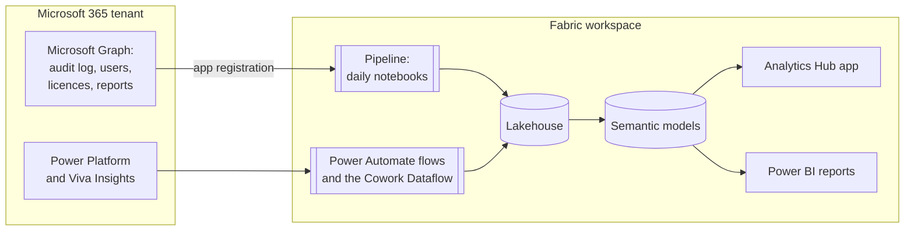
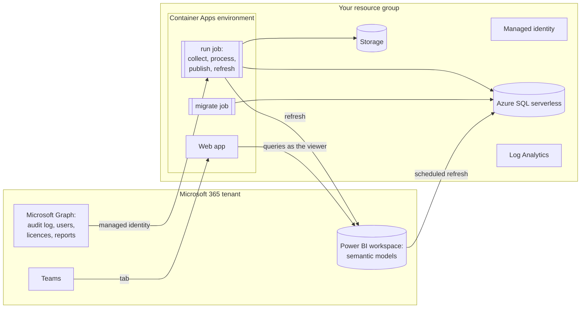
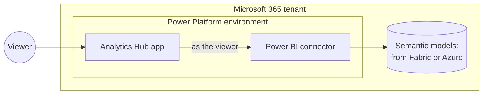

# Architecture and costs

Analytics Hub runs entirely in your tenant. It reads Microsoft 365 data with read-only permissions,
keeps it in your Fabric workspace or Azure subscription, and shows it in an app and Power BI
reports. The app can also run as a [Copilot Managed App](#copilot-managed-app) (preview).

## What it collects

Everything is read-only, and stays in your tenant.

| Source | What | |
|---|---|---|
| Purview audit log | Each Copilot interaction: who, when, which app or agent | Always |
| Microsoft 365 licences | Who has a Copilot licence | Always |
| Entra ID, or a Workday export | Department, job title, manager and location | Always |
| Microsoft 365 usage reports | Everyday Teams, Outlook, Word and other activity | On by default |
| Agent 365 registry | Each agent, its owner and who can reach it | Optional, Fabric |
| Copilot Studio, Cowork and Azure AI | Credits used, and what they cost | Optional |
| Microsoft Defender, Azure Resource Graph | AI apps in use, agent risk and configuration, Foundry | Optional |
| Copilot Studio transcripts | How well agents answer | Optional, Fabric |
| Product feedback export | What people say about Copilot | Optional, Fabric |

What each optional source needs: [Optional extras](PREREQUISITES.md#optional-extras). Each table
and column: [Data dictionary](DATA-DICTIONARY.md).

## Fabric

- The **pipeline** runs the notebooks on a schedule, daily by default. They sign in as the
  **Analytics Hub Data Collector** app registration.
- The optional **flows** and **Dataflow** bring in Copilot Studio credits, product feedback and
  Cowork credits.
- The **semantic models** hold the measures. The app and the reports read the same models.

## Azure

- The **run job** collects and processes the data, writes it to Azure SQL, and refreshes the
  Power BI models. It signs in as a **managed identity**, so there's no secret to rotate for it.
- The **web app** queries the models as the person viewing, so they see only what they're allowed
  to. It also runs as a Teams tab.
- The job images come from public GHCR, so no container registry is needed.
- With [private networking](../installer/README.md#networking), SQL, Storage and Log Analytics
  go behind private endpoints, and Power BI refreshes through a VNet data gateway.

## Copilot Managed App

Preview. Microsoft hosts the app, and it loads no data: it reads the models of a Fabric or Azure
install. See [Copilot Managed App](MANAGED-APP.md).

- **`npm run deploy:managed`** builds the `app` folder, and deploys it to an environment with
  Microsoft's managed apps command line.
- Each query goes through the viewer's own **Power BI connection**, so they see only what they're
  allowed to.
- There's **no app database**. Settings and report packs stay in each viewer's browser.

## Running costs

Analytics Hub itself is free. It runs on services your organisation pays for. Prices vary by
region and agreement; the installer's plan lists what's billed, with links to the pricing pages.

| | Fabric | Azure |
|---|---|---|
| Compute and storage | A [Fabric capacity](https://azure.microsoft.com/pricing/details/microsoft-fabric/), F2 or larger. F64 or larger for more than 10,000 people. Or a [60-day free trial](https://learn.microsoft.com/fabric/fundamentals/fabric-trial#method-1-start-a-new-trial-capacity-from-the-account-manager). | About $5–40 a month for a small tenant, or $60–160 a month for a large one: [Container Apps](https://azure.microsoft.com/pricing/details/container-apps/), [Storage](https://azure.microsoft.com/pricing/details/storage/blobs/), [Azure SQL](https://azure.microsoft.com/pricing/details/azure-sql-database/single/) and Log Analytics. |
| Private networking | — | About $30–40 a month more, and gateway capacity units while refreshing. |
| Viewers | [Power BI Pro or PPU](https://www.microsoft.com/power-platform/products/power-bi/pricing) each, below F64. | Power BI Pro or PPU each. |
| Flows | [Power Automate Premium](https://www.microsoft.com/power-platform/products/power-automate/pricing) for whoever signs in to the Studio credits flow. | The same. |
| Ask | Capacity units, on a paid capacity. Not on a trial. | Azure OpenAI tokens, per question. |
| Key Vault | Only if you keep the secret there. [Billed per operation](https://azure.microsoft.com/pricing/details/key-vault/): small for a few reads a day. | Not used. |

**Copilot Managed App** (preview): the Fabric or Azure install it reads from, plus
[Power Apps Premium or Copilot Credits](https://learn.microsoft.com/microsoft-365/admin/manage/apps/licensing-faq)
for each viewer. Without Premium, each query costs 0.1 Copilot Credits, and opening the app 0.1
more. Viewers still need Power BI Pro below F64.

Estimate Azure costs with the [Azure pricing calculator](https://azure.microsoft.com/pricing/calculator/).
Copilot credits aren't charged by Analytics Hub on Fabric or Azure: it reads what you've already
used.
