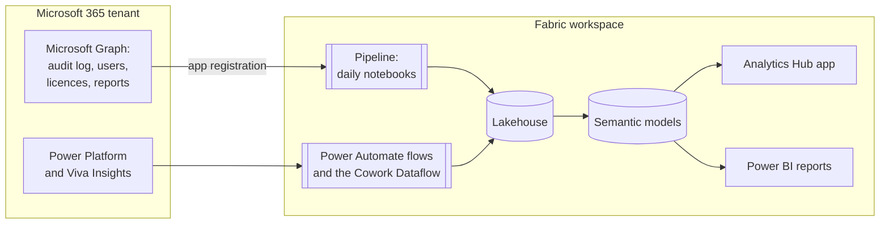
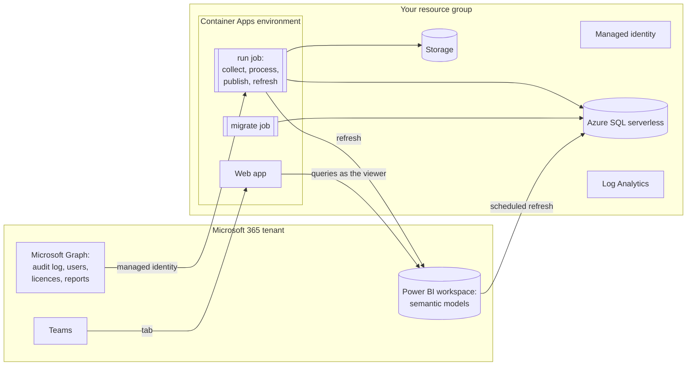

# Architecture and costs

Analytics Hub runs entirely in your tenant. It reads Microsoft 365 data with read-only permissions,
keeps it in your Fabric workspace or Azure subscription, and shows it in an app and Power BI
reports.

## Fabric

- The **pipeline** runs the notebooks on a schedule, daily by default. They sign in as the
  **Analytics Hub Data Collector** app registration.
- The optional **flows** and **Dataflow** bring in Copilot Studio credits, product feedback and
  Cowork credits.
- The **semantic models** hold the measures. The app and the reports read the same models.

## Azure

- The **run job** collects and processes the data, writes it to Azure SQL, and refreshes the
  Power BI models. It signs in as a **managed identity**, so there's no secret to rotate for it.
- The **web app** queries the models as the person viewing, so they see only what they're allowed
  to. It also runs as a Teams tab.
- The job images come from public GHCR, so no container registry is needed.
- With [private networking](../installer/README.md#networking), SQL, Storage and Log Analytics
  go behind private endpoints, and Power BI refreshes through a VNet data gateway.

## Running costs

Analytics Hub itself is free. It runs on services your organisation pays for. Prices vary by
region and agreement; the installer's plan lists what's billed, with links to the pricing pages.

| | Fabric | Azure |
|---|---|---|
| Compute and storage | A [Fabric capacity](https://azure.microsoft.com/pricing/details/microsoft-fabric/), F2 or larger. F64 or larger for more than 10,000 people. Or a [60-day free trial](https://learn.microsoft.com/fabric/fundamentals/fabric-trial#method-1-start-a-new-trial-capacity-from-the-account-manager). | About $5–40 a month for a small tenant, or $60–160 a month for a large one: [Container Apps](https://azure.microsoft.com/pricing/details/container-apps/), [Storage](https://azure.microsoft.com/pricing/details/storage/blobs/), [Azure SQL](https://azure.microsoft.com/pricing/details/azure-sql-database/single/) and Log Analytics. |
| Private networking | — | About $30–40 a month more, and gateway capacity units while refreshing. |
| Viewers | [Power BI Pro or PPU](https://www.microsoft.com/power-platform/products/power-bi/pricing) each, below F64. | Power BI Pro or PPU each. |
| Flows | [Power Automate Premium](https://www.microsoft.com/power-platform/products/power-automate/pricing) for whoever signs in to the Studio credits flow. | The same. |
| Ask | Capacity units, on a paid capacity. Not on a trial. | Azure OpenAI tokens, per question. |
| Key Vault | Only if you keep the secret there. [Billed per operation](https://azure.microsoft.com/pricing/details/key-vault/): small for a few reads a day. | Not used. |

Estimate Azure costs with the [Azure pricing calculator](https://azure.microsoft.com/pricing/calculator/).
Copilot credits aren't charged by Analytics Hub: it reads what you've already used.
