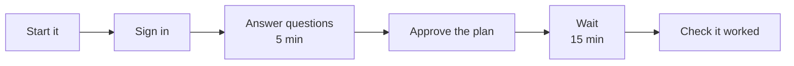

# Install

The installer sets up Analytics Hub on Fabric or Azure. Check the [Prerequisites](PREREQUISITES.md)
first. To set it up by hand instead, see [Manual install](MANUAL-INSTALL.md).



## Run it

1. **Start the installer.** Paste this into PowerShell:

   ```powershell
   irm https://github.com/microsoft/AnalyticsHub-Dashboard/releases/latest/download/install.ps1 | iex
   ```

   Or [download the exe](https://github.com/microsoft/AnalyticsHub-Dashboard/releases/latest/download/AnalyticsHubInstaller.exe)
   and open it. Blocked? See [Other ways to start it](#other-ways-to-start-it).
2. **Wait for your browser.** The first time, it takes about a minute to unpack. Keep its window
   open, and keep the PC awake and plugged in, until the installer says setup is finished.
3. **Choose Set up Analytics Hub** and sign in.
4. **Choose where it runs:** **Microsoft Fabric** or **Your Azure subscription** (`--target azure`).
5. **Answer the questions** (about 5 minutes):
   - **Data sources.** Each has a card: **Connected (API)**, **Upload CSV** or **Skip**. A CSV card
     says where to export the file. See
     [Data sources and exports](../installer/README.md#data-sources-and-exports).
   - **Advanced settings.** **No** keeps what you chose last time, or the defaults. See
     [Advanced settings](../installer/README.md#advanced-settings).
   - **Capacity, size and workspace**, or on Azure the subscription, resource group, region and
     Power BI workspace. Either way, **About how many people work in your organisation?** starts
     from the installer's count of everyone with a licence and an enabled account, not only those
     with Copilot.
   - **App registration.** Create one, use your own (it's checked first), or
     [let an admin register it](../installer/README.md#if-you-cant-register-apps).
   - **Where the secret goes** (Fabric only). In the notebooks by default, or a Key Vault (a vault
     admin can add the secret if you can't). See
     [Where the secret goes](../installer/README.md#where-the-secret-goes).
6. **Approve the plan.** Nothing is created until you choose **Go ahead**. The installer stops
   Windows going to sleep while it runs.
7. **Wait** until the installer says setup is finished: about 15 minutes. The first load of audit
   history then carries on in Fabric or Azure, so you can close the window, and `status` shows how
   far it has got. See [How long it takes](PREREQUISITES.md#how-long-it-takes).
8. **Open the app** from the link once the first load has finished (`status` shows it too), then
   [check it worked](#check-it-worked).

<details>
<summary><strong>Good to know</strong></summary>

- **Change an answer.** Choose **Back** on any question or on the plan. Your answers are kept, and
  the questions after it are asked again. If you go back to the client secret, leave the box empty
  to keep the one you pasted. Go back further and you're asked for it again.
- **The plan** shows every setting, including the defaults, and a **Costs** list of what's billed
  (the Fabric capacity, Power Automate Premium for the flows, the Azure resources), with links to
  the pricing pages.
- **Data sources.** Copilot usage, licences and org data are always connected. Microsoft 365
  activity is on by default; the rest are skipped until you choose otherwise. The **Copilot Studio
  credits**, **Copilot Cowork credits** and **Azure AI costs** cards make up
  [Credit consumption](../installer/README.md#credit-consumption). A source that needs more, such
  as a Power Platform environment for a flow, asks for it next.
- **Names.** A new workspace is named `Analytics Hub` and its Lakehouse `Analytics_Hub`, or the
  next free name. New items are named after Analytics Hub, such as `Analytics Hub Model`,
  `AnalyticsHub_Pipeline`, the `Analytics Hub SQL …` connection and the `Analytics Hub Data Collector` app registration. An install from
  an earlier version keeps its names, such as `ValueLens Model`.
- **Capacity.** F64 or larger is recommended for more than 10,000 people. On Azure, so is letting
  Azure SQL carry on past its free allowance, for about $30-80 a month. The plan shows the cost. A
  [large tenant](../installer/README.md#a-large-tenant) takes longer to load.
- **Azure.** Only regions that pass the [region preflight](../installer/README.md#regions-and-images)
  are offered. For [private networking](../installer/README.md#networking), choose **Yes** for the
  advanced settings. More in [Azure target](../installer/README.md#azure-target).
- **The first load.** The plan estimates it beside the history question. With 30 days of history
  and up to 10,000 people, it takes 1 to 2 hours on Fabric and 2 to 3 hours on Azure; a
  [large tenant](../installer/README.md#a-large-tenant) takes longer, and days on Fabric. On
  Fabric, if you keep the installer open, it checks the data when the load finishes and lists
  what's left.
- **Copilot Studio credits** arrive after the Studio flow's first run. See
  [Load the Studio credits now](../installer/README.md#power-automate-flows).
- **A workspace that already has things in it.** The installer never changes anything it didn't
  create. If a name is taken, its own item gets the next free name, such as
  `AnalyticsHub_Pipeline_2` or `Analytics Hub 2`. The plan shows the names first.
- **The install record.** Your answers are kept in `Documents\Analytics Hub\valuelens-install.json`.
  Keep that folder. Start the installer again the same way to run the pipeline, check status,
  update or repair. **Manage Analytics Hub** shows the record's path. If OneDrive syncs your
  Documents folder, the record follows you to your other PCs.
- **The workspace has gone.** After you sign in, the installer checks the record's workspace still
  exists. If Fabric says it doesn't, or the record is for another tenant, choose **Start fresh**
  (the old record is kept, renamed with the date and time, such as
  `valuelens-install.20260507-090302.json`) or **Keep this record**. In the terminal, `install`
  asks. If Fabric can't be reached, or you can't read the workspace, nothing changes.
- **If you close the page,** go back to the installer's window and press **Enter**.
- **Updates.** See [Update or remove](UPDATE.md).

</details>

## Other ways to start it

They all run the same installer and ask the same questions. If your organisation's policy blocks
a route, don't work around it. Use another route, or ask your IT team.

| Your PC | Start with |
|---|---|
| Windows 10 or 11 | [The PowerShell one-liner](#from-powershell) |
| Windows, and you'd rather download a program | [The exe](#run-it). To check it, see [Check the download](#check-the-download) |
| Windows, with a Node.js your IT team has approved | [IT-approved Node.js](#it-approved-nodejs) |
| Locked down, or not Windows | [Azure Cloud Shell](#locked-down-tenant--azure-cloud-shell) |
| Nothing can run locally, and no Cloud Shell | Your IT team deploys it, for example with Intune or Configuration Manager, or you run it from an approved admin workstation |
| A clone of this repo, with Node.js | [Without the exe](#without-the-exe) |
## Check it worked

1. **Read the Done page.** It lists what's left, as cards: who does each step and a message to
   send. See [After it finishes](#after-it-finishes).
2. **Check what loaded.** After the first run, each source has a card: loaded, warning, failed,
   skipped or still running. A failed card says why and what to do. On Fabric, the same is in the
   Lakehouse table `dbo.load_log`. See [Load status and reruns](../installer/README.md#load-status-and-reruns).
3. **Check status.** Open the installer again and choose **Check status** (`status`): recent runs,
   model refreshes, secret expiry and the last data check. It shows how much audit history has
   loaded, and a load of history that couldn't start, with its command. On Azure it also shows the
   job runs, the web app's URL and pending admin actions. It changes nothing.
4. **Check the data** (Fabric). **Check the data** (`check`) reads the Lakehouse tables for row
   counts, date ranges and licence matches, without running the pipeline.
5. **Open the app.** Open the link the installer gives you. Each page lists the latest date each
   of its sources holds. Pages for sources you skipped stay empty.

Something failed? Choose **Rerun failed loads** (`rerun-failed`), or see
[Troubleshooting](TROUBLESHOOTING.md).

### After it finishes

- **What's left comes first.** The Done page (and the end of the terminal output) starts with
  "N steps left": a card for each thing still to do, in order, with who does it, why, a link and
  the steps. For a step another admin does, the card has a message to copy and send:
  - **Share the app**, if you chose **Later** when asked.
  - **Sign in to the Power Automate flows**, for you or a Power Platform administrator.
  - **Sign in to the Cowork Dataflow.** Until then its refresh fails on each run. That's expected,
    so the load shows it as waiting rather than failed.
  - **Ask a Viva Insights analyst for the Cowork credits query** (optional), when Cowork credits
    come from the CSV export.
  - **Ask a Privileged Role Administrator for Global Reader** for **Analytics Hub Data
    Collector**, when agent configuration comes from Azure Resource Graph. The message has the
    app's IDs, the link to Roles & admins, and a Cloud Shell command.
  - **Ask a Microsoft 365 admin to schedule the product feedback export**, when its flow is on.
- **Admin consent.** If you couldn't grant it, send the link the installer gives you to an admin.
  They select **Grant admin consent**. Then open the exe again and choose **Run now**.
- **Share the app and reports.** The installer creates **Analytics Hub Viewers** (or uses a group
  you name) with you as owner, and gives it **Build** on the models. Then:
  1. **Once:** share the app with the group. Straight after the app is deployed, before the first
     load, the installer asks you to, with a link to the app item in Fabric: choose **Share**, add
     the group and choose **Grant**. (Or in the workspace, choose **…** next to the
     **Analytics Hub** app, then **Share**.) Choose **I've shared it** and it isn't asked again.
     Choose **Later** and it's a card on the Done page, and Repair asks again. Do the same for the
     **ValueLens** report.
  2. **To give someone access:** add them to the group in
     [My Groups](https://myaccount.microsoft.com/groups). You can also run `access`
     (**Manage access** in the browser) or use **Share** in the app.

  Keep viewers off workspace roles. See [Viewing Analytics Hub](PERMISSIONS.md#viewing-analytics-hub-paths-1-and-2).
- **Own reports.** Connect Power BI Desktop to `Analytics Hub Model`, or use **Save a copy** on a
  published report.
- **Flows and the Cowork Dataflow.** If you chose them, the end of the install lists what to sign
  in to. See [Power Automate flows](../installer/README.md#power-automate-flows) and
  [Credit consumption](../installer/README.md#credit-consumption).
- **Someone else takes over the pipeline?** The notebooks run as the person who last changed the
  pipeline, or the schedule's owner. Give them Key Vault Secrets User on the vault and Contributor
  on the workspace first. With the secret in the notebooks, they only need Contributor.
- **Secrets expire.** See [Secrets expire](UPDATE.md#secrets-expire).

## Check the download

Each [release](https://github.com/microsoft/AnalyticsHub-Dashboard/releases) lists the
exe's SHA-256, which is also in `AnalyticsHubInstaller.exe.sha256`. To check your copy, run this in
PowerShell, in the folder you downloaded it to:

```powershell
(Get-FileHash .\AnalyticsHubInstaller.exe -Algorithm SHA256).Hash
```

It should match, ignoring capitals. If it doesn't, delete the file and download it again.
`install.ps1` checks the zip's SHA-256 for you the same way.

A matching hash confirms the file is the one in the release. It doesn't confirm who published
it: the exe and `install.ps1` aren't code-signed yet. On a PC your organisation doesn't manage,
Edge may say the exe isn't commonly downloaded, and Windows SmartScreen may say it protected your
PC. On a managed PC, if policy blocks the exe, use the [PowerShell one-liner](#from-powershell) or
another route in [Other ways to start it](#other-ways-to-start-it), or ask your IT team.

## From PowerShell

Paste this into PowerShell (Windows PowerShell 5.1 or PowerShell 7). It runs the same installer
as the exe, with the same browser steps:

```powershell
irm https://github.com/microsoft/AnalyticsHub-Dashboard/releases/latest/download/install.ps1 | iex
```

It downloads `AnalyticsHubInstaller.zip` from the latest release (about 120 MB: Node.js, the
installer and the app, already built), checks its SHA-256 against the one written into
`install.ps1`, unpacks it under `%LOCALAPPDATA%\AnalyticsHub` and opens the installer in your
browser. It needs no admin rights, installs nothing system-wide and changes no settings. Run it
again to pick up a new version; it removes the old one.

- **Later commands.** It leaves a command behind for the version it unpacked, for example
  `& $env:LOCALAPPDATA\AnalyticsHub\analytics-hub.cmd status`. With no arguments it opens the
  browser steps.
- **A fixed version.** Each release's notes give a command pinned to that release, such as
  `irm https://github.com/microsoft/AnalyticsHub-Dashboard/releases/download/installer-v0.6.6/install.ps1 | iex`.
  A pre-release is only reachable this way: `releases/latest` skips pre-releases. If that
  release's zip has since been removed, the command says so, prints the `releases/latest`
  command to run instead and stops. It doesn't switch versions on its own.
- **Download and run.** To keep the files, download `install.ps1` and `AnalyticsHubInstaller.zip`
  from the [release](https://github.com/microsoft/AnalyticsHub-Dashboard/releases/latest) and,
  where your execution policy allows scripts, run
  `.\install.ps1 -ZipPath .\AnalyticsHubInstaller.zip`. Anything after the options goes to the
  installer, for example `... -ZipPath .\AnalyticsHubInstaller.zip status`.
- **If policy blocks it.** If execution policy, endpoint protection or another control blocks
  `irm | iex` or the script, don't work around it. Use another route in [Other ways to start it](#other-ways-to-start-it), or
  ask your IT team.
- **Behind a proxy.** It uses the system proxy. To name one, signed in as you, run
  `$env:ANALYTICS_HUB_PROXY = 'http://proxy:8080'` first. If the proxy blocks GitHub's download host,
  download the zip in a browser and set `$env:ANALYTICS_HUB_ZIP` to its path, or use `-ZipPath`.
- **Constrained Language Mode** works: the launcher only uses commands allowed there. It skips
  keeping the PC awake, so keep it plugged in and awake yourself.
- **Run it from a desktop session**, at the PC or over Remote Desktop. Over SSH, a Fabric install
  may not be able to deploy the app: see [Known issues](TROUBLESHOOTING.md#installing).
- **Remove it** with `.\install.ps1 -Uninstall` (from the download-and-run steps above), or by
  deleting `%LOCALAPPDATA%\AnalyticsHub`. That doesn't touch what's in your tenant, or your
  install record in `Documents\Analytics Hub`. To remove what's in your tenant, use **Uninstall**
  in the installer first.

AppLocker or Windows Defender Application Control rules that block programs under your profile
stop the unpacked `node.exe`, as they stop the exe. The launcher and the exe spot this and say
what to do instead of showing the raw error. If your IT team has approved a Node.js install, for
example from Company Portal, use [IT-approved Node.js](#it-approved-nodejs). Otherwise use
[Azure Cloud Shell](#locked-down-tenant--azure-cloud-shell), or ask your IT team.

## IT-approved Node.js

If your organisation has installed an approved Node.js (22.13 or later, or 24; x64), the
PowerShell launcher can run the installer with it instead of the `node.exe` in the zip:

```powershell
$env:ANALYTICS_HUB_USE_INSTALLED_NODE = '1'; irm https://github.com/microsoft/AnalyticsHub-Dashboard/releases/latest/download/install.ps1 | iex
```

Or, from the [download-and-run](#from-powershell) files, `.\install.ps1 -ZipPath .\AnalyticsHubInstaller.zip -UseInstalledNode`.

- **Which Node.js.** The `node` on your PATH. It stops if that's missing, too old or not x64.
- **What's still downloaded.** The same zip, checked the same way and unpacked to
  `%LOCALAPPDATA%\AnalyticsHub`: the installer's JavaScript, the templates, and the prebuilt app
  with the packages Rayfin needs to deploy it. The zip's `node.exe` is unpacked but not run.
- **What still runs from your profile.** On a Fabric install, Rayfin loads two unsigned native
  add-ons when it signs you in itself. See
  [Unsigned files in the download](TROUBLESHOOTING.md#unsigned-files-in-the-download). If policy
  blocks those too, use [Azure Cloud Shell](#locked-down-tenant--azure-cloud-shell) or ask your IT
  team. An Azure install loads none.
- **Same install.** It uses the same folders and the same install record as the other Windows
  routes, so you can switch routes without a second install. The command it leaves behind,
  `analytics-hub.cmd`, keeps using the approved Node.js, and the update command the installer
  shows keeps the setting.

## Locked-down tenant / Azure Cloud Shell

If your PC can't run the exe or the PowerShell command (AppLocker, WDAC, or no local PowerShell at
all), run the installer in [Azure Cloud Shell](https://shell.azure.com) instead. Nothing runs on
your PC: the installer runs in Cloud Shell and asks its questions in the terminal. Choose
**PowerShell** in Cloud Shell and paste the same command:

```powershell
irm https://github.com/microsoft/AnalyticsHub-Dashboard/releases/latest/download/install.ps1 | iex
```

In Cloud Shell, `install.ps1` doesn't download the Windows zip. It fetches the release's source
from GitHub at the commit written into `install.ps1`, checks it got that commit, and installs the
installer's packages with `npm ci` from the lockfile. If Cloud Shell's Node.js is older than 22.13,
it downloads the Node.js version the release was built with from nodejs.org and checks its SHA-256
against the list nodejs.org publishes. It all goes in `~/.analytics-hub`. The first run takes a
minute or two.

- **Options.** To pass options or a command, run
  `& ([scriptblock]::Create((irm https://github.com/microsoft/AnalyticsHub-Dashboard/releases/latest/download/install.ps1))) --use-az status`.
  In Bash, run `pwsh -c "irm https://github.com/microsoft/AnalyticsHub-Dashboard/releases/latest/download/install.ps1 | iex"`.
- **Later commands.** It leaves `~/.analytics-hub/analytics-hub` behind, which works from Bash or
  PowerShell, for example `~/.analytics-hub/analytics-hub status`. To update, run the `irm` command
  again.
- **Terminal only.** Cloud Shell can't open the installer's page in your browser, so `--ui` isn't
  available. The terminal asks the same questions.
- **Signing in.** By default the installer signs you in with a code: it shows a code and a link,
  and you sign in on any device. The tokens stay in memory, so each run asks again. Cloud Shell's
  own sign-in, which the Azure CLI uses until you sign it in, can't get tokens for some of the APIs
  the installer uses. To use `--use-az`, first run `az login --use-device-code`. The installer
  checks the Azure CLI can reach every API it uses before it changes anything, and says which it
  couldn't. The Azure CLI stays signed in between Cloud Shell sessions.
- **If Conditional Access blocks sign-in with a code**, Cloud Shell can't run the installer:
  both ways of signing in use a code there. Ask whoever manages Conditional Access, or run the
  installer on a PC that's allowed.
- **Keep the install record.** It's in `~/analytics-hub/valuelens-install.json`. Your home folder
  is kept between sessions only if Cloud Shell has a storage account (it then has `~/clouddrive`);
  `install.ps1` warns if it doesn't, and so may a tenant policy that changes new storage accounts
  so Cloud Shell can't mount them. Without the record, running the installer again sets up a
  second copy, so in that case download it before you close Cloud Shell: choose **Manage files** >
  **Download** and enter `analytics-hub/valuelens-install.json`. The installer reminds you at the
  end of each run. In a new session, upload it with **Manage files** > **Upload** and run the
  installer again: it moves the uploaded record from your home folder to where it looks. To carry
  on from a PC later, put the record in `Documents\Analytics Hub`.
- **Idle timeout.** Cloud Shell ends a session after 20 minutes without input. If that stops the
  installer, run the same command again: it reuses what's in the install record, skips finished
  steps and doesn't create a second app. With `--no-wait` the installer doesn't wait for the
  first load: it stops once setup is finished, and the load carries on in Fabric or Azure. Run
  `status` later to see how far it has got.
- **The app.** The installer builds the app from source in Cloud Shell and deploys it with your
  installer sign-in, so Rayfin doesn't open a browser. The build needs a few hundred MB in your
  home folder (Cloud Shell gives you 5 GB). If deploying fails, copy the install record to a
  Windows PC and run `deploy-app` there.
- **Remove it** with
  `& ([scriptblock]::Create((irm https://github.com/microsoft/AnalyticsHub-Dashboard/releases/latest/download/install.ps1))) -Uninstall`,
  or by deleting `~/.analytics-hub`. Your install record stays.

`install.ps1` spots Cloud Shell from the environment variables it sets. To force it either way,
set `$env:ANALYTICS_HUB_CLOUD_SHELL` to `1` or `0` first. Cloud Shell is the PowerShell launcher's
only Linux target; on other Linux or macOS machines, use [Without the exe](#without-the-exe).

## Without the exe

If you can't run the exe, run the installer from a clone of this repo with Node.js 22.13 or later:

```text
cd "installer"
npm install
npx valuelens-install --ui
```

Leave out `--ui` to answer the questions in the terminal. Other commands: `run`, `check`,
`refresh`, `status`, `update`, `deploy-app`, `rotate-secret`, `upload`, `prereqs` and `preview`. Add `--help` for
options. The exe takes the same commands, for example `AnalyticsHubInstaller.exe status`.
`install --yes` keeps the secret in the notebooks for a new Fabric install; read
[the trade-off](../installer/README.md#where-the-secret-goes) first, and add `--key-vault` to use Key Vault instead.
`--secret-days <n>` sets how long the secret in the notebooks lasts.
On Azure, `install --target azure --yes` stops before anything is deployed for a new install of
more than 10,000 people, until you choose what Azure SQL does when the free offer's monthly
allowance runs out. Add `--sql-scale-up` to carry on past it (about $30-80 a month), or
`--sql-free-offer` to keep the free offer, which pauses the database and the jobs until next month.
See [A large tenant on Azure](../installer/README.md#a-large-tenant-on-azure).
